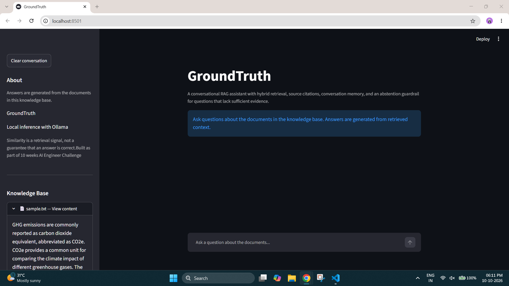

# GroundTruth — Conversational RAG

A conversational Retrieval-Augmented Generation (RAG) application that answers questions using a local knowledge base, retrieves relevant context, and presents source references to help users understand where answers come from.

GroundTruth combines hybrid retrieval, local LLM inference, conversation memory, citation validation, and an abstention guardrail in a Streamlit interface.

## Features

- **Hybrid retrieval:** Combines keyword-based and semantic retrieval to find relevant document chunks.
- **Local LLM inference:** Uses Ollama with `qwen2.5:1.5b` for answer generation.
- **Streaming responses:** Displays generated answers progressively in the user interface.
- **Source references:** Shows retrieved context alongside responses.
- **Citation validation:** Checks citation references against the available sources.
- **Conversation memory:** Uses recent conversation history to support follow-up questions.
- **Abstention guardrail:** Avoids answering questions when retrieved context does not meet the configured similarity threshold.
- **Local knowledge base:** Demonstrates retrieval using the project's sample document.

## Architecture

1. **Document ingestion:** Loads documents from the knowledge base.
2. **Chunking:** Splits documents into smaller pieces suitable for retrieval.
3. **Indexing:** Prepares document chunks for semantic and keyword search.
4. **Hybrid retrieval:** Retrieves candidate chunks and ranks relevant context.
5. **Query handling:** Uses recent conversation history to help interpret follow-up questions.
6. **Guardrail:** Checks retrieval relevance before generating an answer.
7. **Answer generation:** Sends the question and retrieved context to the local Ollama model.
8. **Citation handling:** Displays sources and validates citation references.
9. **Streaming UI:** Presents the answer and supporting context through Streamlit.

## Screenshots

### Application interface



## Demo Recordings

The repository includes two recordings demonstrating the application.

- **UI walkthrough:** `recordings/ui.mp4`
- **Conversation demo:** `recordings/conversation.mp4`

These recordings demonstrate the interface and conversational workflow without requiring a permanently hosted inference service.

## Run Locally

### Prerequisites

- Python 3.12
- [Ollama](https://ollama.com/)
- Git

### 1. Clone the repository

```bash
git clone <your-repository-url>
cd <your-repository-folder>
```

### 2. Create and activate a virtual environment

Windows PowerShell:

```powershell
python -m venv .venv
.\.venv\Scripts\Activate.ps1
```

### 3. Install dependencies

Install the packages listed in the project's `requirements.txt`.

```powershell
python -m pip install -r requirements.txt
```

### 4. Download the model

```powershell
ollama pull qwen2.5:1.5b
```

Ensure the Ollama service is running.

### 5. Launch the application

From the project root:

```powershell
python -m streamlit run app.py
```

Open the local URL printed by Streamlit.

## Testing

Run the existing unit tests from the project root:

```powershell
python -m pytest -v
```

The tests cover selected citation-validation and conversation-memory behaviours.

## Project Goal

GroundTruth explores how to build a more transparent RAG workflow by combining retrieval, source visibility, conversation context, and guardrails in one application.
